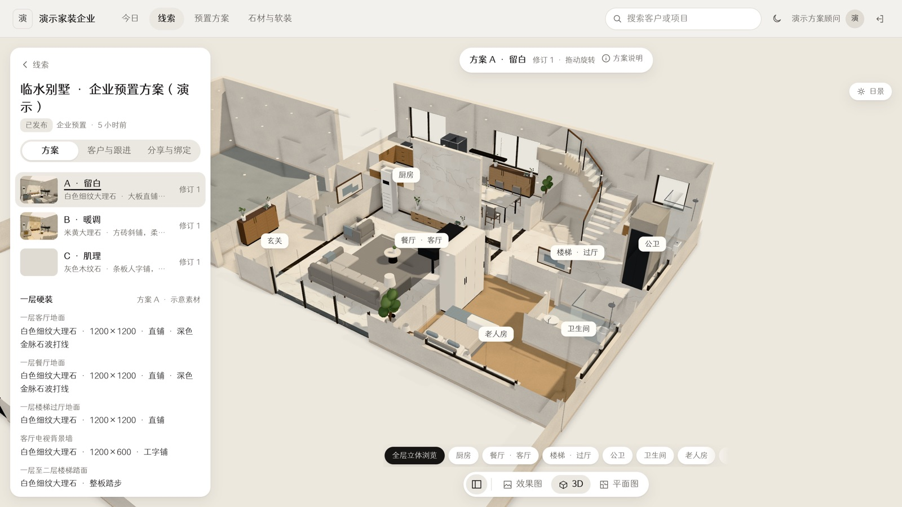
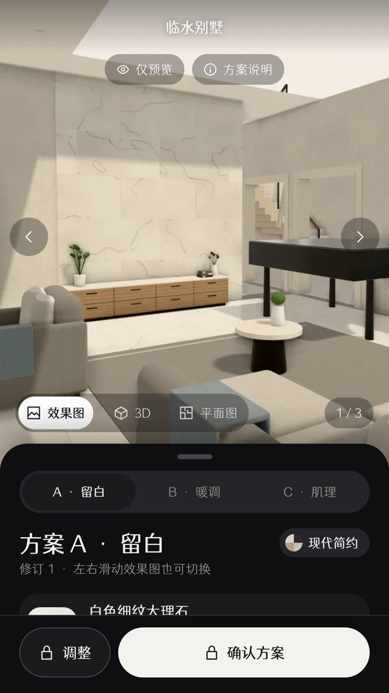
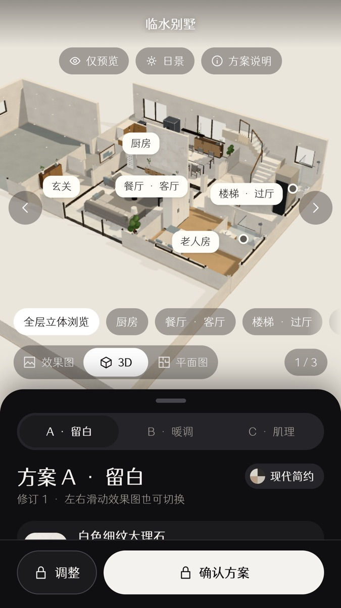
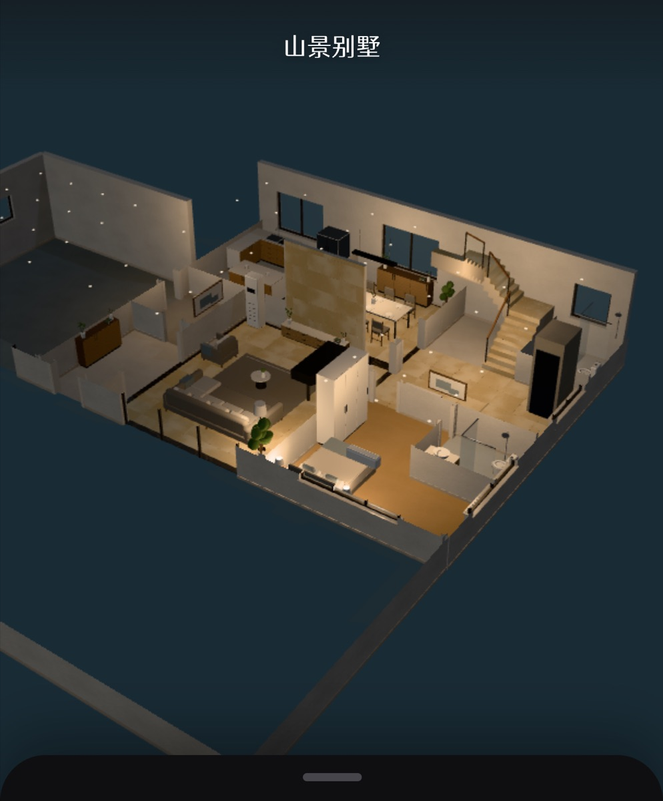
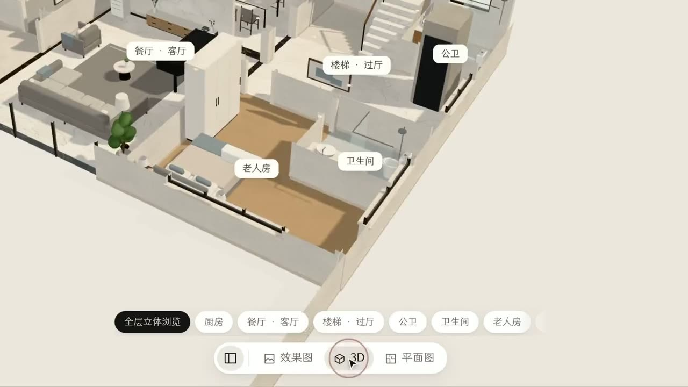
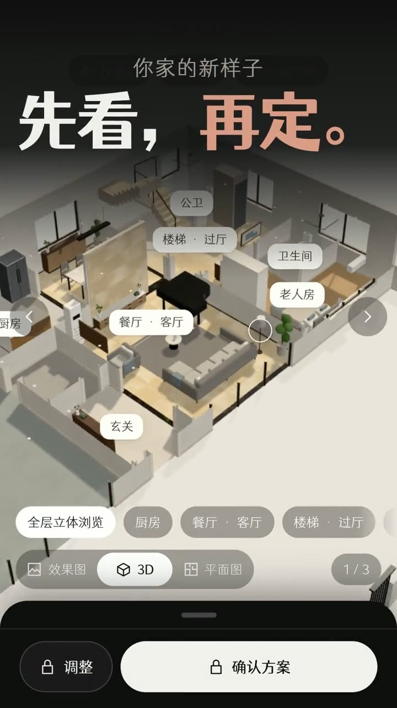
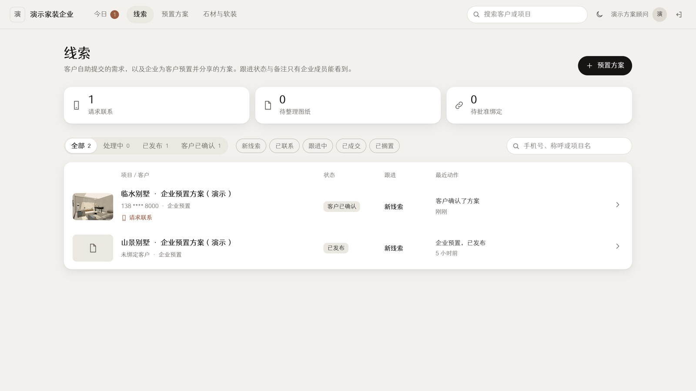

# Hestia

[简体中文](README.md) | English

**A space design platform for home renovation companies.** Customers upload a floor plan and get stone finish and soft furnishing schemes, then compare and confirm them on their phone in 3D, plan view and rendered images. Companies follow up leads, prepare and publish schemes in a workbench, with an Agent that drafts scheme candidates.

Named after Hestia, the Greek goddess of the hearth and, in myth, the first builder of homes.



<table>
  <tr>
    <td width="33%"></td>
    <td width="33%"></td>
    <td width="33%"></td>
  </tr>
  <tr>
    <td align="center">Rendered images · switch schemes</td>
    <td align="center">Full-storey 3D view</td>
    <td align="center">Night lighting</td>
  </tr>
</table>

## Promo videos

<table>
  <tr>
    <td width="64%"><a href="docs/assets/video/hestia-enterprise.mp4"></a></td>
    <td width="36%"><a href="docs/assets/video/hestia-owner.mp4"></a></td>
  </tr>
  <tr>
    <td align="center">▶ Enterprise workbench (30 s)</td>
    <td align="center">▶ Client app (30 s)</td>
  </tr>
</table>

The UI is in Simplified Chinese; it targets users in mainland China.

## Features

**Client app (H5, embeddable in a WeChat Mini Program web-view)**

- Phone number sign-in; DXF floor plans are converted automatically and get schemes right away, while photos / PDF / DWG go to the company's preparation queue
- Compare whole schemes (stone finishes + soft furnishing style) as rendered images, a full-storey 3D view down to single rooms, plan views (real materials / white model / wireframe) and day / night lighting
- Adjust by picking options and confirm a scheme; open a company's prepared scheme with a share code and bind it to your account

**Enterprise workbench**

- "Today" to-dos, lead list and detail, follow-up status and internal notes
- Floor plan preparation queue, prepared schemes, share codes and binding management
- Stone and soft furnishing catalogs, multi-storey spaces
- Agent assistant: chat inside a lead to generate whole-scheme candidates; members adopt a candidate as a draft for review, and customers see it only after it is published

**Platform admin**

- Onboard companies with per-domain access; customer accounts and data are isolated per company
- Model registry (OpenAI Chat Completions / OpenAI Responses / Anthropic Messages protocols); assign models, monthly quotas and concurrency limits to each company
- Per-call token and cost metering, platform-level and company-level usage reports with CSV export; company data export and deletion



## Architecture

| Layer | Technology |
| --- | --- |
| Web and API | Next.js 16 + React 19 (`apps/web`) |
| Background jobs | pg-boss queues + a finite-state runner, persisted SSE events; tasks keep running and resume after the page closes (`apps/worker`) |
| Model calls | AI SDK Core; models are registered in the admin, never hard-coded |
| Data | PostgreSQL 17 + Drizzle ORM, multi-tenant isolation per workspace |
| 3D and rendering | Three.js (`packages/scene-runtime`), headless-browser rendering in the background |

## Repository layout

```text
apps/web/                        Next.js app: site entry, client app, enterprise workbench, platform admin and API
apps/worker/                     Workers for model calls, rendering and floor plan conversion
packages/                        Shared contracts, domain services and scene runtime
example/prototypes/projects/     Workbench prototype (sources in src/, build output included)
assets/fonts/tsanger-yuyang/     Tsanger YuYang font and its license notice
scripts/                         Build, local setup, migration and validation scripts
docs/                            Product scope, architecture, decisions and validation records
```

## Quick start

Requires Node.js 22+, the pnpm version pinned in `package.json`, and Docker (for local PostgreSQL).

```sh
pnpm install --frozen-lockfile
pnpm db:up               # local PostgreSQL (Docker); skip if you have one
pnpm bootstrap           # .env, migrations, job queues, render browser, DXF tooling
pnpm demo:seed --reset   # demo company, demo accounts and prepared schemes
pnpm dev:all             # web and workers: http://127.0.0.1:3000
```

Demo data calls no models and SMS is simulated, so it runs offline. Demo settings and accounts are in the [offline demo guide](docs/demo/home-h5-demo.md). The Agent assistant needs a model registered in the platform admin. Development and verification commands are in [Development](docs/development.md).

## Documentation

Project documentation is written in Chinese.

- [Status](docs/status.md) · [Product context](PRODUCT.md) · [Domain language](CONTEXT.md) · [Decision records](docs/decisions/)
- [Tech stack](docs/web-stack.md) · [Design system](DESIGN.md) · [Development](docs/development.md) · [Validation records](docs/validation/)
- [Contributing](CONTRIBUTING.md) · [Third-party notices](THIRD_PARTY_NOTICES.md)

## License

The code is released under the [MIT License](LICENSE). Third-party code and fonts are used under their own terms, see [Third-party notices](THIRD_PARTY_NOTICES.md); the Tsanger YuYang font is not covered by MIT, see its [license notice](assets/fonts/tsanger-yuyang/NOTICE.txt).
