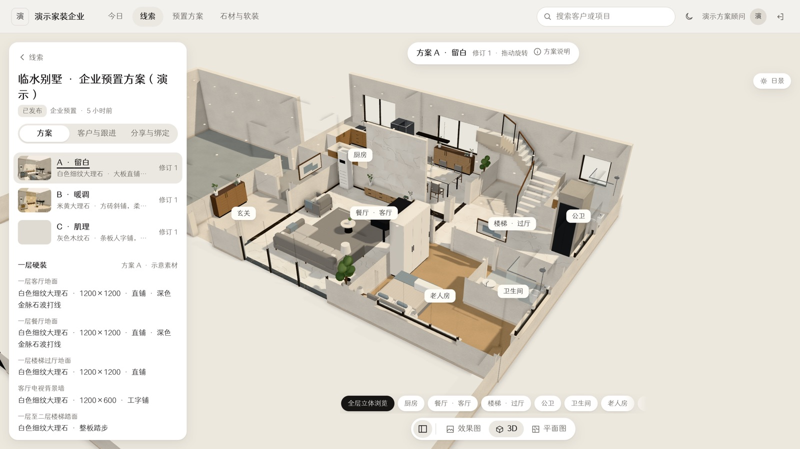
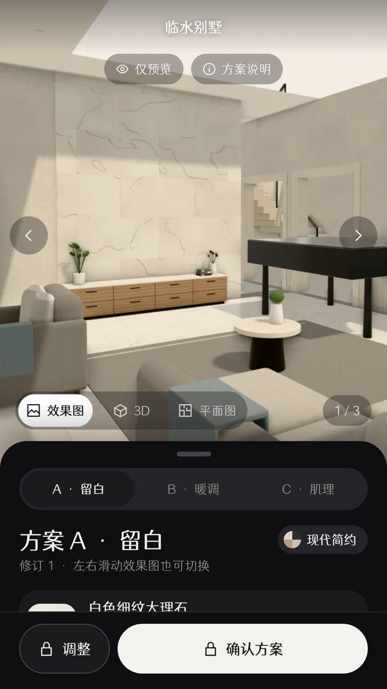
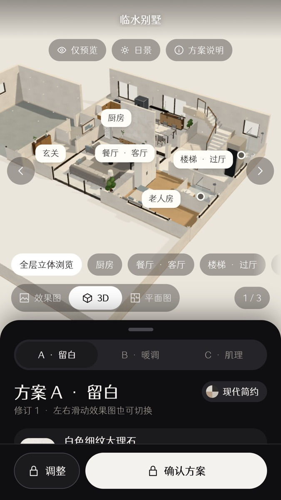
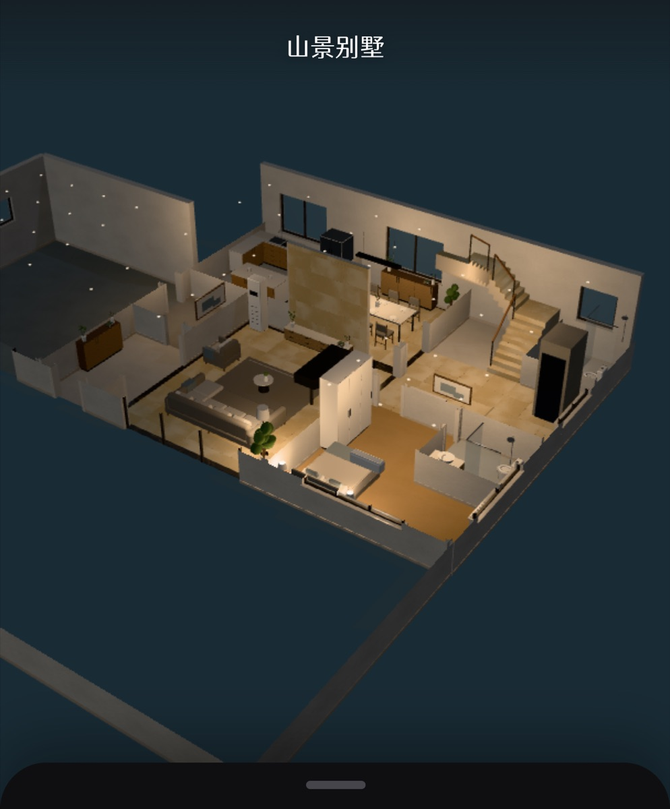
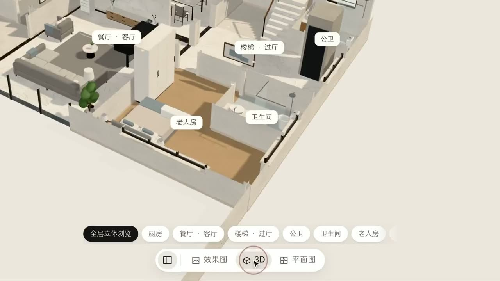
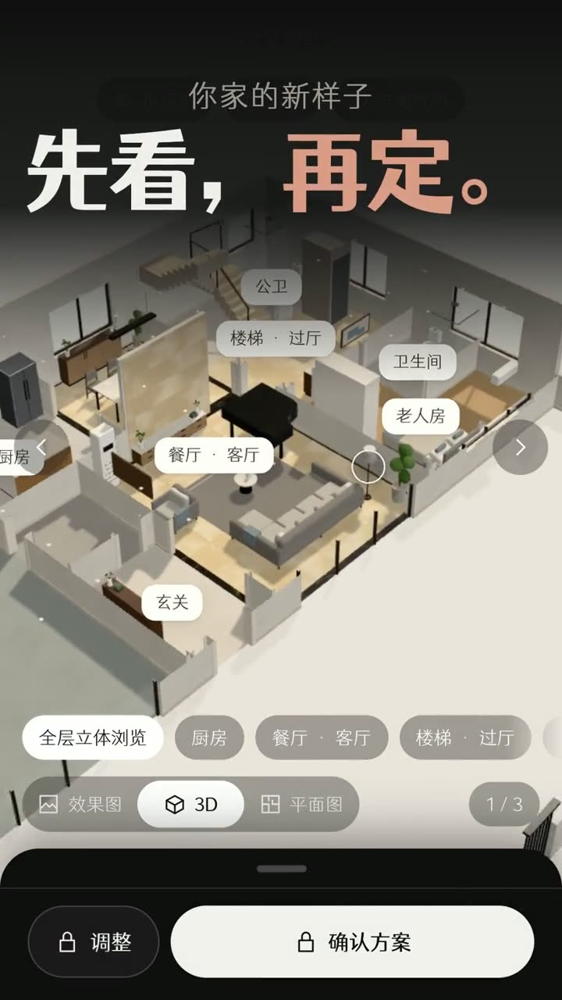
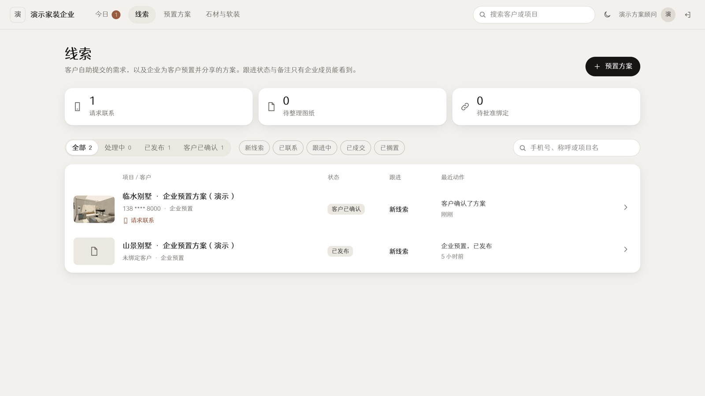

# Hestia

简体中文 | [English](README.en.md)

**面向家装企业的空间设计平台**：客户上传户型图纸即可得到石材铺贴与软装方案，在手机上以 3D、平面图和效果图对比确认；企业在工作台跟进线索、预置与发布方案，并由 Agent 生成方案候选。

名字取自古希腊神话中的炉火女神赫斯提亚，造屋之始祖。



<table>
  <tr>
    <td width="33%"></td>
    <td width="33%"></td>
    <td width="33%"></td>
  </tr>
  <tr>
    <td align="center">效果图 · 多方案切换</td>
    <td align="center">3D 全层立体浏览</td>
    <td align="center">夜景灯光</td>
  </tr>
</table>

## 宣传片

<table>
  <tr>
    <td width="64%"><a href="docs/assets/video/hestia-enterprise.mp4"></a></td>
    <td width="36%"><a href="docs/assets/video/hestia-owner.mp4"></a></td>
  </tr>
  <tr>
    <td align="center">▶ 企业工作台（30 秒）</td>
    <td align="center">▶ 客户端（30 秒）</td>
  </tr>
</table>

## 功能

**客户端（H5，可嵌入小程序 web-view）**

- 手机号登录；上传 DXF 图纸自动转换并直接出方案，照片 / PDF / DWG 进入企业整理队列
- 多套整体方案（硬装铺贴 + 软装风格）对比：效果图、3D 全层浏览 → 房间、平面图（真实材质 / 白模 / 线框）、日景 / 夜景
- 选项式调整与确认方案；输入企业分享码打开预置方案并绑定

**企业工作台**

- 「今日」待办、线索列表与详情、跟进状态与内部备注
- 图纸整理队列、预置方案、分享码与绑定管理
- 石材与软装目录，多楼层空间
- Agent 助手：在线索中对话生成整套方案候选，成员采用后作为待审方案，发布后客户可见

**平台后台**

- 企业开通与按域名接入，客户账号与数据按企业隔离
- 模型登记（OpenAI Chat Completions / OpenAI Responses / Anthropic Messages 协议），向企业分配模型、月度额度与并发上限
- 按调用计量 token 与金额，平台与企业两级用量统计、CSV 导出；企业数据导出与删除



## 架构

| 层 | 技术 |
| --- | --- |
| Web 与 API | Next.js 16 + React 19（`apps/web`） |
| 后台任务 | pg-boss 队列 + 有限状态运行器，SSE 事件持久化，关页后任务可继续与恢复（`apps/worker`） |
| 模型调用 | AI SDK Core，模型由后台登记，不写死在代码中 |
| 数据 | PostgreSQL 17 + Drizzle ORM，多租户按工作空间隔离 |
| 3D 与出图 | Three.js（`packages/scene-runtime`），无头浏览器后台出图 |

## 目录

```text
apps/web/                        Next.js 应用：官网入口、客户端、企业工作台、平台后台与 API
apps/worker/                     模型调用、出图与图纸转换 Worker
packages/                        共享契约、领域服务与场景运行时
example/prototypes/projects/     工作台原型（源码在 src/，含构建产物）
assets/fonts/tsanger-yuyang/     仓耳渔阳体字体与授权声明
scripts/                         构建、本地环境、迁移与验证脚本
docs/                            产品范围、架构、决策与验收记录
```

## 快速开始

需要 Node.js 22+、`package.json` 指定的 pnpm 与 Docker（本地 PostgreSQL）。

```sh
pnpm install --frozen-lockfile
pnpm db:up               # 本地 PostgreSQL（Docker）；已有数据库可跳过
pnpm bootstrap           # .env、数据库迁移、后台队列、出图浏览器、DXF 环境
pnpm demo:seed --reset   # 演示企业、演示账号与预置方案
pnpm dev:all             # Web 与 Worker：http://127.0.0.1:3000
```

演示数据不调用模型、短信为模拟发送，可离线运行；演示配置与账号见 [离线演示说明](docs/demo/home-h5-demo.md)。Agent 助手需在平台后台登记模型后启用。开发与验证命令见 [开发与验证](docs/development.md)。

## 文档

- [项目现状](docs/status.md) · [产品上下文](PRODUCT.md) · [领域语言](CONTEXT.md) · [决策记录](docs/decisions/)
- [技术栈](docs/web-stack.md) · [设计系统](DESIGN.md) · [开发与验证](docs/development.md) · [验收记录](docs/validation/)
- [参与开发](CONTRIBUTING.md) · [第三方声明](THIRD_PARTY_NOTICES.md)

## 许可

本项目代码以 [MIT](LICENSE) 许可发布。第三方代码与字体依各自声明使用，见 [第三方声明](THIRD_PARTY_NOTICES.md)；仓耳渔阳体不在 MIT 范围内，见 [字体授权](assets/fonts/tsanger-yuyang/NOTICE.txt)。
