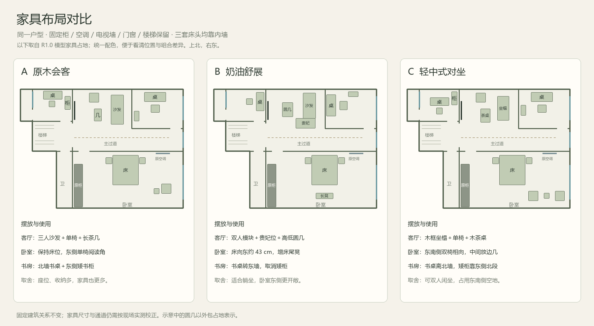

# My IdealHome

从一张手绘户型图和多次口述纠正，逐步还原一个可以浏览、比较家具布局的家。

**目前提供双方向的 Agent 工作台前端原型，以及原单户型展示。** 新原型可操作项目管理、图片导入、手动校准描墙、家具编辑、演示对话和独立 3D 展示。尚未接入自动识图、真实大模型、账号或云端协作。

## 工作台原型：两种方向对比

建筑展馆采用深蓝侧栏、冷白编辑区和模型目录；家居杂志采用横向导航、暖纸背景与精选项目排版。共用同一套本地项目数据。

```sh
npm ci
npm run check:prototype
npm run preview:prototype
```

打开 [原型对比入口](http://127.0.0.1:4173/)，从任一方向进入项目，再点击「展示预览」进入独立浏览页。也可以下载后直接打开 [原型 HTML](output/prototype/index.html)。建议使用本地服务，以获得稳定的浏览器存储行为；`file:` 与 `http:` 的项目数据不互通。

- 可新建、搜索、重命名、复制项目，导入 PNG / JPG / WebP 图片并手动校准、描墙；PDF 请先转换为图片。
- 在平面图拖动家具，或通过属性修改位置与朝向；支持锁定、撤销重做、本地保存和 JSON 导出。JSON 重新导入尚未提供。
- 演示助手能执行“床向右移动 30 厘米”等有限指令；明确标注演示模式，不调用模型或收集密钥。
- 独立展示页支持材质 / 白模 / 线框、昼夜、隐藏家具和截图。示例户型还支持单独查看房间、房间漫游与室内灯光。

图纸导入不会自动生成墙体；新项目由用户手动绘制。家具移动没有工程级碰撞与通行校验。当前版本用于体验流程和比较视觉方向。

[原型范围与设计契约](docs/prototype-brief.md) · [产品上下文](PRODUCT.md) · [V1 功能范围](docs/v1-scope.md) · [生产技术栈规划](docs/web-stack.md) · [开发计划](docs/v1-development-plan.md)



## 原单户型展示

下载仓库后，用支持 WebGL 的 Chrome / Edge 打开 [当前离线 HTML](output/3d/ideal-home-3d.html)。GitHub 文件页本身不会执行 HTML，需要下载到本地打开。

HTML 内嵌模型、材质、样式和 Three.js，不需要账号、后端或网络。仓库没有上传服务，也没有连接 AI API。

目前可用：

- 无天花板的全屋 3D、平面图、真实材质 / 白模 / 线框。
- 日夜切换、室内灯光、家具显示 / 隐藏、墙体剖切。
- 点击房间或家具查看说明，单独查看空间，进入房间漫游。
- A 原木会客、B 奶油舒展、C 轻中式对坐：家具位置、朝向、种类与数量确实不同。
- 导出当前模型视角 PNG。

## 本地开发

要求 Node.js 22 或更高版本。以下命令在仓库根目录执行：

```sh
npm ci
npm run build
npm test
```

或运行 `npm run check`，依次构建和检查。构建输出仍为 `output/3d/ideal-home-3d.html`，保持原有打开路径。

`npm test` 检查三套家具组合、模型中的物体占地穿插、固定物品位置、主要通道、漫游起点、显示模式与隔离状态。测试用真实 Three.js 几何体，Canvas 绘图使用替身；**通过测试不等于完成浏览器画面验收，也不等于验证了真实房屋尺寸。** 详细说明见 [开发与验证](docs/development.md)。

可选：更新布局对比图（不影响 HTML 构建）：

```sh
python -m pip install Pillow
python scripts/render-layout-comparison.py --font /path/to/chinese-font.ttf
```

先运行 `npm run check` 生成家具占地数据。Windows 可省略 `--font` 使用系统微软雅黑；其他系统需可用的中文字体。

## 项目结构

```text
src/                         交互页面、几何模型、家具布局和材质
scripts/                     构建、几何检查、可选对比图绘制
examples/sample-home-2f/           当前示例的已确认关系与建模假设
docs/                        架构、开发、历史决策与产品化讨论
output/3d/ideal-home-3d.html   当前可直接打开的离线交付物
output/3d/layout-comparison-r10.png
.github/workflows/ci.yml      Windows / Linux 构建与几何检查
AGENTS.md                    本项目的 agent 工作约定
```

历史 PDF、旧版 HTML、临时截图、旧检查报告和 `node_modules` 保留在原工作区，不纳入当前仓库。

## 示例的边界

示例以二楼为代表层，整栋房屋共四层。原固定柜、挂式空调、电视墙、柱子、门窗与楼梯的已确认关系保留；部分尺寸来自记忆，层高、窗洞与楼梯几何仍包含展示假设。它用于布局与视觉讨论，尚未经过现场测绘。

房屋事实以 [示例说明](examples/sample-home-2f/README.md)、[假设记录](examples/sample-home-2f/assumptions.json) 和 [决策记录](docs/decisions.md) 为依据。`assumptions.json` 是记录，不是驱动模型生成的输入文件；目前几何仍写在 `src/model.js` 中。

预算功能已撤下，当前版本不提供装修报价、施工图或隔热效果模拟。

## 文档与许可

- [架构与可复用部分](docs/architecture.md)
- [V1 功能范围](docs/v1-scope.md)（规划，未实施）
- [Web 技术栈与密钥边界](docs/web-stack.md)（多用户浏览器直连建议）
- [开发阶段与验收](docs/v1-development-plan.md)
- [完整流程设想与瓶颈](docs/product-workflow.md)（讨论稿，未实施）
- [参与开发](CONTRIBUTING.md)
- [版本记录](CHANGELOG.md)
- [第三方声明](THIRD_PARTY_NOTICES.md)

本项目尚未选择开源许可证，`package.json` 暂标为 `UNLICENSED`，不因提交 GitHub 自动授予开源许可。Three.js 与 esbuild 依各自许可证使用；离线 HTML 保留 Three.js 的 MIT 声明。
