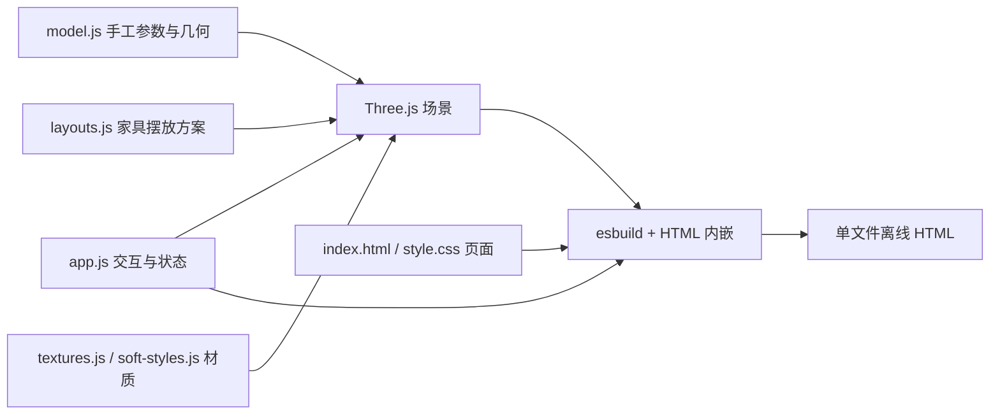

# 当前架构

## 已实现的结构

`model.js` 定义这个示例的房间、坐标、墙体、门窗、家具和灯光。它不是从图纸解析出的通用数据结构。

`layouts.js` 保存三套家具变换与显示条件。每次切换先恢复模型初始状态，再应用方案，更新房间描述、可见家具和障碍物占地。原木、奶油和轻中式同时绑定对应材质；现阶段不是两个相互独立的布局/风格选择轴。

`soft-styles.js` 克隆可变家具材质，固定物品不参与配色切换。`app.js` 维护房间选择、物品选择、视图、材质模式、昼夜与漫游等状态。

构建将 Three.js、程序生成的模型、纹理代码、CSS 全部打包到 HTML。运行时只需要浏览器 WebGL。

## 坐标约定

模型按米表达：平面 `x` 向东、`z` 向南，`y` 向上。`model.root` 平移 `(-5, 0, -4.5)` 以适配相机；房间和方案仍使用平面坐标。这个根偏移在部分交互代码里是硬编码，泛化时必须统一封装，避免只改一处导致碰撞和点击位置错位。

当前墙位跨度不等于实测净尺寸，尤其不能直接用外轮廓面积替代用户最初估计面积。

## 可复用部分

- Three.js 浏览、平面/立体切换、白模/线框、选择、空间隔离。
- 灯光、基础材质和部分程序家具。
- 方案切换与状态更新思路。
- 单文件离线导出的构建方式。

## 需要重做或抽离的部分

- 房间矩形组合、墙体坐标、窗洞、楼梯和家具实例混在模型构造代码中。
- 房间目录和小平面图轮廓也有手写数据，尚未由统一户型数据派生。
- 相机初始位置、根偏移、漫游范围、固定设施列表绑定当前示例。
- 检查脚本针对这个房子的方案，不是通用规则引擎。
- 缺少上传、文件解析、尺度校准、可编辑二维底图、项目保存、撤销和历史版本。
- 缺少外部家具资产库及真实规格数据。

`examples/yushan-2f/assumptions.json` 记录事实和假设，尚未成为渲染输入。将其改成 JSON 并不自动意味着支持任意户型。

下一步建议先把“户型数据 → 建筑几何 → 家具方案”分离，在不调用识图服务的情况下让两个不同的户型数据都能生成场景，再接图纸识别。该建议尚未实施。
