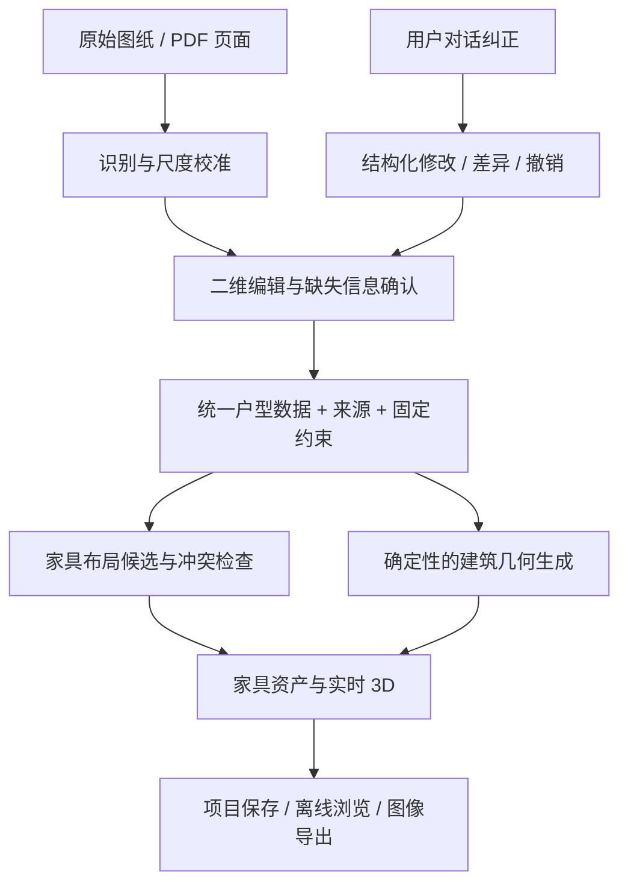

# 从单户型原型到完整流程：讨论稿

状态：2026-10-19 的可行性讨论，未进入平台实现，也没有确定上线时间或商业模式。

## 判断

可以做成“上传平面图 → 校准与纠错 → 生成可编辑 3D → 比较家具布局 → 导出”的工具。当前项目验证了后半段的交互形式，但尚未实现前半段。

“从一张不完整手绘图自动还原真实房屋”不能作为可靠承诺。图上没有的层高、窗台、承重属性和真实尺寸，需要其他资料或用户补充。我们这次反复调整的阳台、楼梯、固定柜与尺度，正是需要产品化的校正环节。

## 建议用户流程

1. **上传并选范围**：先支持单层 PNG/JPEG 与 PDF 页面；区分清晰设计图、扫描图、手绘图。保留原图，允许裁切、旋转、选择有效页面。
2. **确认尺度与朝向**：点击一条已知边、输入实测长度；变形照片还要做透视纠正并用更多尺寸复核。不以一张照片加一个长度承诺全图准确。
3. **叠图校正户型**：识别外轮廓、墙、房间、门窗；在原图上覆盖结果。用户能拖墙、补洞口、删误识别线、修改门向，未知处明确待确认。
4. **锁定现实约束**：哪些柜子、柱子、空调、墙、门窗保留；哪里很热、哪里要安静、哪些房间必须独立。固定设施与家具方案分开保存。
5. **先看建筑白模**：先确认形状、尺度、开口和楼梯，再加家具。二维底图和三维模型来自同一份数据，避免各改各的。
6. **生成真正不同的摆法**：以座位数、使用区域、家具组合和动线差异形成备选；允许用户拖放替换。风格配色另选，不把换色称为新布局。
7. **对话修改并预览差异**：例如“床向右 30 cm，原柜不动”，转成可检查的数据修改；显示受影响尺寸和冲突，支持撤销和版本比较。
8. **导出与保存**：保留项目数据、来源和版本；导出可打开的 3D 或平面示意。照片感效果图只能作为附属视觉结果，不覆盖几何数据。

## 最关键的技术分层

AI 适合解释图纸、提出缺失信息问题、理解修改意图和推荐布局；墙如何相接、门窗如何开洞、家具如何移动，应由几何和规则代码确定。不要每上传一张图就重新生成一份定制 JavaScript。

建议建立版本化的项目数据，至少包含：楼层与房间、墙段与厚度、洞口及所属墙、固定设施、家具实例、单位与坐标约定、方案、来源和确认状态。确认状态区分“图上读数、用户估计、用户确认、现场实测”，不要用没有校准过的百分比假装可靠度。

固定位置、固定尺寸、必须保留等锁定属性应分开；修改引用的墙时，要显式更新门窗、依附柜体和相邻房间。项目数据才是事实源，3D 网格只是派生结果。

## 主要瓶颈

| 瓶颈 | 当前示例暴露的问题 | 应对方式 |
| --- | --- | --- |
| 输入信息不足或矛盾 | 手绘比例与记忆面积不一致 | 用户校准、来源记录、冲突提示、允许未知 |
| 识别与几何拓扑 | 墙线断裂、家具线误认、门洞归属、凹形轮廓 | 识别后修复拓扑，提供二维纠错，不只提高识别分数 |
| 编辑器与变更传播 | 改卧室宽度会影响外轮廓、窗和家具 | 统一数据、稳定 ID、约束关系、撤销和版本差异 |
| 楼梯和三维细节 | 两个平台、27 级、上下楼与连续扶手 | 单独参数化模板及人工确认；第一版可作为占位例外 |
| 家具布局质量 | 无穿插并不等于舒服；换颜色不等于新摆法 | 检查门扇、椅子拉出、柜门、路径，再比较使用取舍 |
| 家具资产与视觉质量 | 当前家具是程序示意，没有 SKU | 合法可用的资产库、统一单位/朝向/尺寸与简化层级 |
| 保存与信任 | 用户纠正后不能被下一轮生成覆盖 | 事实锁定、可审查修改、历史版本、原图叠加 |
| 速度与运行成本 | 识图、几何与渲染不是同一种工作负载 | 局部更新、缓存、分阶段任务；用样本实测延迟与资源消耗 |

只有碰撞测试是不够的：还应测出入口连通、门柜开合、座椅活动空间和固定约束违例。舒适性阈值要按家具用途和用户要求配置，不能将示例里的几何容差写成通用设计规范。

## 建议先做的最小闭环

第一阶段先支持单层、以直墙为主、带至少一项可靠尺寸的图纸。对复杂楼梯、曲墙、跨层挑空提供明确的手动占位和纠正方式，不承诺自动复原。

建议先后顺序：

1. **先拆数据**：把当前样例从 `model.js` 的具体坐标中抽出。再用第二套完全不同的户型检验，证明同一生成器可复用。
2. **做校正编辑器**：导入背景图、标尺、墙段与门窗编辑、锁定固定设施、保存与恢复。即使自动识别失败也能完成流程。
3. **再接识图**：生成可校正的初稿，保留不确定项；对比人工从头描图究竟节省多少工作。
4. **加入受约束布局**：先使用尺寸可靠的家具模板，输出有功能差异的方案，提供修改和撤销。
5. **再提升效果**：真实资产、灯光细化、多层模型、扫描输入和高质量渲染。

验收不只看“有没有生成漂亮图”。先准备获得使用授权的不同输入样本，分别记录：轮廓/门窗错误、人工纠正时间、尺度误差、固定约束违例、布局区别、保存后能否复原、加载与渲染耗时。没有真实样本结果前，不给统一识别率或零人工承诺。

## 外部依据与可选路线

- [CubiCasa5K 论文与数据集](https://github.com/CubiCasa/CubiCasa5k)展示了平面图对象识别任务，但其[仓库许可](https://github.com/CubiCasa/CubiCasa5k/blob/master/LICENSE)为 CC BY-NC 4.0。不能把公开下载等同于可直接用于商业产品；模型、数据与家具资产都需分别确认使用范围。
- [Apple RoomPlan](https://developer.apple.com/augmented-reality/roomplan/)提供使用相机和 LiDAR 的房间采集路线，可作为未来替代输入；它不是任意平面图图片识别接口。Apple 的[技术说明](https://machinelearning.apple.com/research/roomplan)也讨论了遮挡、玻璃和房间差异带来的重建难点。
- [Khronos glTF](https://registry.khronos.org/glTF/)可用于后续家具资产和运行时 3D 场景交付。它解决资产交换，不替代户型语义数据、编辑约束或施工图。

以上是技术可行性的参考，不是本项目已经接入的服务，也不代表某个工具能直接解决完整流程。

## 本轮待讨论

优先解决“有设计图的用户校正并布置”，还是“只有手绘和记忆的旧房用户还原现状”？前者更适合作为第一版输入边界，后者可以成为特色，但需要更强的引导问答与纠正工具。

建议先确定这个输入范围和核心输出是否仍为可编辑、可漫游的 3D；不要同时承诺自动装修设计、精确施工图、报价和照片级效果。
