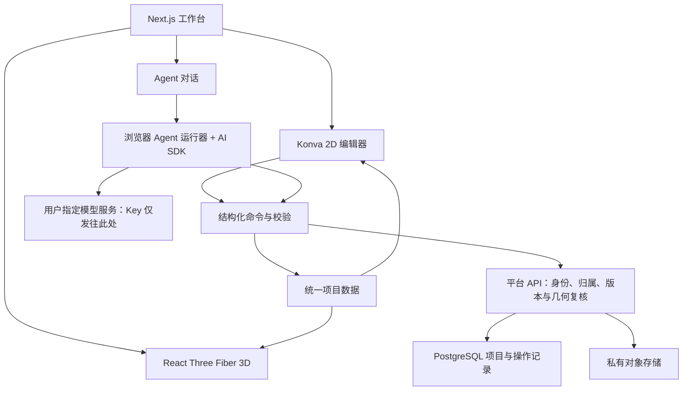

# Web 技术栈决策

日期：2026-10-19。状态：确定 V1 的建议技术基线，尚未安装依赖或迁移应用。本文约定“采用”指后续开发选型，不代表仓库已实现。

建议交付基线：多用户、桌面编辑优先，模型密钥不经过平台服务器。用户已询问此形态的可行性，但尚未最终确认部署选择；以下据此给出可审查方案。当前 `package.json` 仍然是旧原型依赖，不能据此运行本文中的未来应用。

## 1. 选型结论

| 层次 | 采用 | 选择理由与边界 |
| --- | --- | --- |
| 应用框架 | Next.js App Router + React + TypeScript | 页面、项目 API 与鉴权在同一仓库；编辑器和模型调用运行在客户端 |
| UI | Tailwind CSS + shadcn/ui | 组装表单、面板、对话框与工作台；不再为每种状态手写全部基础控件 |
| 客户端状态 | Zustand | 管理选择、镜头、交互草稿和缓存；正式项目通过统一命令服务写入，不以 store 代替数据库 |
| 二维编辑 | Konva + react-konva | 处理底图、墙线、门窗、选中、拖动和变换；吸附、约束和尺寸逻辑仍由领域层实现 |
| 三维展示 | Three.js + React Three Fiber + Drei | 延续现有 Three.js 几何经验，用 React 管理场景生命周期和交互；不把渲染节点作为事实数据 |
| PDF 页面 | PDF.js | 浏览器中选择与渲染 PDF 页面，模型接口统一接收标准图像 |
| Agent / 模型适配 | Vercel AI SDK + `@ai-sdk/openai-compatible` | 选用可在浏览器打包的调用模块，在客户端执行有限工具循环；P0 必须验证浏览器运行、流式与供应商跨域，不能直接照搬服务端代理示例 |
| 数据契约 | Zod + TypeScript | 项目数据、API 入参、模型输出和工具参数统一校验；合法 JSON 不等于合法户型，几何另验 |
| 服务端 | Next.js Route Handlers，Node.js runtime | 处理项目、文件授权、身份与经过校验的编辑命令，不接收模型 Key、不代理模型流量 |
| 身份认证 | Better Auth + Drizzle adapter | 首版邀请注册、邮箱密码登录及重置；发信由部署者配置 SMTP；项目所有权鉴权仍由业务代码实现 |
| 数据库 | PostgreSQL + Drizzle ORM | 保存用户、项目、修订和任务检查点；所有读写校验对象归属，不仅在列表页过滤 |
| 文件 | 私有 S3-compatible 对象存储 | 原图和附件按资源 ID 管理；经鉴权颁发短时访问地址，限制大小与类型，完成上传后校验归属和元数据 |
| 后台几何计算 | 纯 TypeScript 模块，必要处 Web Worker | 2D/3D、编辑器和 Agent 共用计算；前端大批量校验可移入 Worker |
| 测试 | Vitest + Playwright | 领域逻辑与数据测试，加真实浏览器的编辑、导入、漫游、导出和视觉检查 |
| 部署 / 包管理 | Node.js 22+、npm lockfile、Docker 应用 + PostgreSQL + S3-compatible 存储 | 初始化时选择仍受支持且兼容的 Node LTS；数据库与对象存储独立持久化；应用部署在 HTTPS 域名 |

不在本轮锁死未经安装验证的包版本。P0 选择当时稳定且相互兼容的版本，使用 lockfile 固定；不在 CI 中浮动安装 `latest`。尤其核对 React、react-konva 和 React Three Fiber 的配套主版本。

## 2. 为什么这样搭配

Next.js 用于组织产品页面和服务端能力。二维编辑器与 WebGL 都按客户端加载，避免服务端访问 Canvas；实时编辑不经过服务端逐帧计算。独立 Vite 前端也能实现，但首版没有必要同时维护一套前端和另一套 API 应用。

Konva 负责二维输入和呈现，Three.js 负责三维呈现，两者都订阅同一个领域模型。不能序列化 Konva 节点后再反推建筑，也不能让 2D 和 3D 各有一套墙坐标。[Konva 官方说明](https://konvajs.org/docs/react/)提供 React Canvas 与事件绑定；几何约束仍需项目实现。

React Three Fiber 是 Three.js 的 React 渲染层，现有程序几何和材质生成可逐步复用；需要改造现有全局状态、固定根偏移和手写房间轮廓。[React Three Fiber 文档](https://r3f.docs.pmnd.rs/getting-started/introduction)

AI SDK 负责供应商调用相关能力，客户端运行器控制有限工具循环；首版的任务阶段、版本和检查点由应用自身保存。SDK 本身不消除供应商跨域限制。暂不叠加 LangGraph、工作流平台、消息队列或多 Agent 框架；浏览器关闭后不承诺继续执行。[AI SDK 工具调用](https://ai-sdk.dev/docs/ai-sdk-core/tools-and-tool-calling)

## 3. 领域模型与数据流



核心对象：`Project`、`Floor`、`Wall`、`Opening`、`Room`、`FixedObject`、`FurnitureInstance`、`LayoutVariant`、`Fact`、`Revision`、`AgentRun`、`ToolOperation`、`ProviderConnection`。

- 统一米、弧度；领域平面使用 `(x, z)`，高程为 `y`。图像像素与米通过单独的 `CalibrationTransform` 转换，北向另存，不把屏幕向上等同真实北向。
- 墙段端点、厚度、高度明确；房间引用围合边界，洞口引用所属墙及墙上偏移，不复制一份游离坐标。
- 对象 ID 稳定。事实记录来源、原始表述、估计/确认/实测状态，避免把模型推断当测量。
- 家具方案引用建筑版本，只存家具实例与变更；建筑改变后标记方案需复核。
- 写入使用 `baseRevision` 做乐观并发检查；即使单用户也防止多个标签页或 Agent 与拖动同时覆盖。
- 编辑命令携带操作 ID，数据库事务记录新版本和幂等结果。读模型可以缓存，正式提交必须由服务端再校验。
- 核心运算与渲染无关，不使用 Three.js mesh 或 Konva node 作为数据库格式。

建议初始目录（未来开发时建立，本轮不创建）：

```text
app/                       页面和 Route Handlers
components/workbench/      工作台布局与通用 UI
features/editor-2d/        二维画布与输入适配
features/viewer-3d/        三维场景与浏览
features/agent/            对话、任务状态、修改预览
domain/                    契约、几何、命令、约束、版本迁移
server/                    鉴权、数据访问、文件授权、命令复核
tests/fixtures/            获得授权的去标识测试户型
```

## 4. BYOK 与任务执行边界

“不上传密钥”定义为：模型 Key 不发送到平台服务器。Key 仍须发给用户选定的模型服务商认证；即使只是由平台转发而不落库，也不满足此定义。

| 路径 | 平台能否收到 Key | 兼容边界 | 首版安排 |
| --- | --- | --- | --- |
| 浏览器直连服务商 | 正常数据路径不经过平台 | 服务商须允许网页来源、认证头、对应接口与流式请求；SDK 也须支持浏览器 | 首选，验证通过的端点才标记完整支持 |
| 本机连接器调用服务商 | 不经过平台；Key 可留在本机程序 | 需要安装本机组件，以及网站与组件的配对、来源限制和浏览器支持验证 | 后续方案，不伪装成纯网页零安装能力 |
| 平台服务器代理 | 平台收到 Key，即使不保存 | 更容易兼容不同服务商 | 不纳入“不经过平台”的方案，不作为静默回退 |

跨域是服务端授权，前端 SDK 不能自行修复；`no-cors` 也不能让应用读取被阻止的模型响应。必须在实际部署域名、目标浏览器和实际端点上测试。[MDN CORS](https://developer.mozilla.org/en-US/docs/Web/HTTP/Guides/CORS)

首版 Key 只在页面内存保存，不写入 localStorage、IndexedDB、URL、Cookie、项目模型、任务记录、日志或错误上报。刷新、退出或换设备后重新填写。连接名称、模型 ID 和非敏感端点配置可同步；拒绝含凭据的 URL，凭据不能混入连接配置。

这是可验证的数据流约定，并非“平台在技术上永远无法获取 Key”的保证：平台下发的网页脚本在调用时能读到内存中的 Key。应提供可检查源码、限制第三方脚本、配置 CSP，并验证遥测与错误处理不收集凭据。若要求网页也完全接触不到长期 Key，应改为本机程序持有 Key，网页只提交受限任务；需单独设计和验证，不能用浏览器本地存储冒充隔离。

账号和模型凭据分离：平台登录会话只授权项目 API；模型 Key 只认证模型服务。用户可使用同一平台账号跨设备查看项目，但每台设备各自提供模型凭据。图纸、布局和确认后的编辑记录会保存在平台，按需送给模型的图像与上下文由浏览器直接发送；Key 不上传并不表示项目资料不上传。

模型输出与浏览器提交都视为不可信输入。平台仍复核账号归属、项目版本、固定约束和几何，再事务性保存。图纸不自动作为外部 URL交给模型抓取，首版直接传所选图像内容。

每次 Agent 请求有限步数、超时和取消。`AgentRun` 记录 running / waiting-input / completed / failed / interrupted，附客户端运行 ID、操作 ID 与检查点；断线后以超时或下次恢复标记中断。用户重新提供 Key 后从最近提交步骤继续，不重复提交已经执行的移动。服务端不保存密钥，因此不能在浏览器关闭后代用户调用模型。

## 5. 几何与布局策略

- 墙体由经过校验的直线段图生成，门窗用分段网格形成洞口，首版避免依赖通用实体布尔运算。
- 支持墙交点拆分、端点吸附、共线合并、闭合轮廓和房间边界检查；重叠洞口及越界开口给出明确错误。
- 初始家具使用尺寸可控的参数模板；碰撞以旋转后的占地多边形检查，不止用轴对齐外包框。
- 门扇和使用区参与检查；通路用可配置网格近似连通验证，注明离散误差。
- AI 提出对象与目标布局，几何模块验证；修复后仍不可行则返回原因，不能静默移动固定设施。
- 暂不选独立空间数据库、物理引擎或完整 CAD 内核。复杂运算是否引入几何库，在 P1 用失败样例验证后决定。

## 6. 当前原型如何迁移

现有原型与离线产物保留可运行状态。先抽出两个户型的数据及纯生成器，再接 React 编辑器；现有 Three.js 的材质、部分家具、相机操作和导出思路可复用，`app.js` 的 DOM 事件不直接搬成 React 状态。

新的 Web 工作台本身需要 Node 服务，不能继续声称整个应用是一个离线 HTML。离线 HTML 保留为**只读导出物**：可浏览、漫游和切换已有方案，不包含模型 Key、AI 请求和完整编辑功能。导出构建可保留 esbuild 作为独立打包工具。

## 7. 官方资料

以下链接用于确认技术能力，不代表已完成项目集成：

- [Next.js Route Handlers](https://nextjs.org/docs/app/getting-started/route-handlers)、[Node / Docker 部署](https://nextjs.org/docs/app/getting-started/deploying)
- [Konva React](https://konvajs.org/docs/react/)、[旋转与缩放](https://konvajs.org/docs/react/Transformer.html)
- [React Three Fiber](https://r3f.docs.pmnd.rs/getting-started/introduction)
- [AI SDK 工具调用](https://ai-sdk.dev/docs/ai-sdk-core/tools-and-tool-calling)、[兼容协议适配](https://ai-sdk.dev/providers/openai-compatible-providers)
- [Drizzle PostgreSQL](https://orm.drizzle.team/docs/get-started-postgresql)、[Better Auth Drizzle adapter](https://better-auth.com/docs/adapters/drizzle)
- [PDF.js](https://mozilla.github.io/pdf.js/)、[Playwright](https://playwright.dev/docs/intro)
