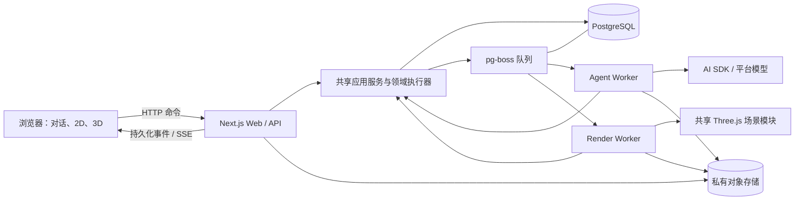

# Hestia 首版技术架构与技术栈

2026-10-25 最新确认：用户亲自将原型移入 `example/prototypes/projects`，保留该目录；生产 UI 只采用家居杂志（editorial），建筑展馆仅保留为原型历史。后文两方向的历史描述不构成生产双主题要求。

日期：2026-10-25。状态：实现架构与技术栈已确认，作为首版实施基线；用户审阅后定稿并明确恢复开发。T03 已验收，T01/T02 已完成合成/协议部分但真实验证待开展，T04 已通过本地验收；首版完整功能尚未验收，部署方案仍不在本轮确认范围内。本文替代旧的浏览器 BYOK 技术方案；产品边界仍以 ADR-0001/0002 为准，已接受的架构取舍见 [ADR-0003](decisions/0003-modular-monolith-with-durable-workers.md)。

已确认选型前提见 [ADR-0004](decisions/0004-mainland-invited-pilot-managed-services.md)：大陆用户无需代理优先；主要由用户与 AI 维护；低成本、少运维，接受托管服务费用并保留迁移能力。原邀请制上线范围已由 [ADR-0006](decisions/0006-open-registration-free-credits.md) 替代为开放注册、注册后赠送积分，游客仅看示例，首期不做匿名账号或付费。预算暂不设定，模型调用费独立核算。本文确认组件选择与职责边界，不代表已集成或通过验收；云产品候选仍仅为研究记录。

## 1. 已确认结论与范围

本轮定稿范围：代码模块、领域数据、Agent 运行与工具执行、前后端接口及渲染边界，以及第 2 节实现组件。云厂商、地域、容器数量、资源规格和费用留待之后讨论，第 7.2 节部署与模型服务候选不随本文定稿获确认。精确版本、供应商和模型型号、性能与预算数值由后续验证确定。

采用 **TypeScript 模块化单体 + 独立后台 Worker + PostgreSQL**。同一个仓库维护 Web、Agent 和领域逻辑，通过进程分开处理用户请求、设计任务和渲染任务；首版不拆成多个独立业务服务。

确定主栈：**Next.js / React / TypeScript、PostgreSQL / Drizzle、pg-boss、AI SDK Core、Three.js、Konva、私有对象存储、Better Auth、Vitest / Playwright、pnpm**。Docker / Docker Compose 作为本地联调和可移植打包工具；生产部署方案另议。

本次确认无需再次逐库询问。实施时先验证版本兼容与业务样本；若验证失败，记录证据并调整对应适配或重新评审架构取舍，不能把定稿等同验证通过。

主语言选择 TypeScript，是为了让前端、空间规则、工具契约与后台共享类型和可复用代码，也能延续现有 Three.js 原型。Python 保留给确有复用收益的图片分析脚本；仅因产品是 Agent 就把整个业务后端改成 Python，会增加两种语言间的契约维护，本项目当前没有足够收益支持这一步。

## 2. 技术选择与理由

| 层次 | 选型 | 在 Hestia 中的职责与选择理由 |
| --- | --- | --- |
| 语言与运行时 | TypeScript strict + Node.js LTS | Web、领域工具和 Worker 共享契约；沿用现有 JavaScript/Three.js 能力。Python 只按需承载已有识图脚本 |
| 包管理 | pnpm workspace | 统一 Web/Worker/共享模块及锁文件；当前以根目录 pnpm-lock.yaml 和 pnpm-workspace.yaml 维护；构建许可与安装兼容按实际依赖核验 |
| Web 应用 | Next.js App Router + React | 同一应用承载页面、会话及项目/任务 API；画布和 3D 为客户端组件，长任务不在请求内执行 |
| UI | 现有 DESIGN 规范 + Tailwind CSS + 按需 shadcn/ui | 参照 example/prototypes/projects 的间距、布局、字体与动画，以 Impeccable 实施、不启用 hooks；中文使用 Tsanger YuYang |
| 浏览器状态 | Zustand 管选择、镜头、临时编辑；TanStack Query 管服务端快照 | 临时交互与项目修订分离；SSE 事件触发查询刷新，不维护第二份权威项目状态 |
| API | HTTP JSON + Zod；SSE 推送任务事件 | 创建任务、回答、采用、取消走请求；进度单向推送，重连按事件游标补齐。首版不需要 WebSocket 双向协作 |
| 领域层 | 纯 TypeScript 的命令、几何与事实模块 | 无浏览器/数据库/模型依赖的几何及规则；服务端负责最终授权、版本和事务 |
| 数据库 | PostgreSQL + Drizzle + SQL migrations | 统一项目、候选、操作、任务、事件、身份及队列存储；关键并发逻辑可直接使用参数化 SQL |
| 后台队列 | pg-boss | 复用 PostgreSQL 调度任务，不新增 Redis。队列唤醒与重试不替代 Hestia 的任务状态、取消、幂等和版本检查 |
| Agent | AI SDK Core + 平台供应商适配器 + 有限状态运行器 | SDK 处理模型协议和工具结构，Hestia 控制阶段、权限、检查点、预算与提交。先单个主 Agent |
| 身份认证 | Better Auth + Drizzle adapter | 邮箱密码注册与登录，用户自行设置密码并支持邮件重置；游客仅看示例，不做匿名账号；业务层复核资源归属。现有邀请身份验收不代表新注册范围已实现 |
| 文件 | 私有对象存储 + 小型文件适配层 | 图纸、缩略图和导出文件独立于数据库；数据库记录归属、版本和文件引用。优先标准 S3 API；具体服务商和签名/导出能力另行选择及验证 |
| 2D 校正 | Konva + react-konva | 叠图、点选、墙端点、门窗与标尺等有限交互；不建设完整 CAD 编辑器 |
| 3D | Three.js + 明确的场景适配器 | 优先提取现有资产、镜头及生成逻辑，通过 React 容器管理生命周期；首版不强制迁移 R3F，不把 mesh 当领域数据 |
| 静态出图 | 渲染 Worker + Playwright Chromium + 同一场景模块 | 后台加载指定修订和资产后出图，不依赖用户开着浏览器；T03 已通过本地合成场景、关页后独立出图及视觉验收；目标环境、生产字体/纹理仍需对应验收 |
| PDF / 图片处理 | PDF.js 选页；必要时受控 Python 识图进程 | 前端选页与预览，后台处理已授权页面；外部脚本经固定输入/输出适配，不向 LLM 开放 shell |
| 验证与观测 | Vitest、Playwright、结构化日志和任务用量记录 | 主要测试服务公开行为，辅以几何夹具、视觉和真实模型评估；按 task/operation/revision 关联证据 |
| 本地联调与打包 | Docker / Docker Compose | 组织 Web、Worker 与本地依赖；Agent/Render 分队列、限并发。生产实例与资源拓扑不在本轮定稿范围 |

选择受支持的 Node LTS，而非仅依据机器当前版本。正式开发时记录 Node、pnpm、PostgreSQL 和所有核心依赖的精确版本，并提交锁文件和迁移；不在此文中猜测未来部署时的最新版。[Node 发布策略](https://nodejs.org/en/about/previous-releases)、[pnpm workspace](https://pnpm.io/workspaces)

## 3. 运行架构

图中的应用服务是 Web 与 Worker 导入的共享代码，并非新增网络微服务；队列的表也在 PostgreSQL 中。独立进程允许不同并发和资源上限，领域规则仍保持一份。

共享模块按依赖方向约束，而不是为每层创建服务：契约只定义输入/输出；领域层实现几何和事实规则；应用服务组织命令与事务边界；基础设施适配数据库、队列、模型和文件；场景模块消费只读领域快照。共享应用服务不导入 Next 的请求/会话对象，Worker 使用从持久化任务绑定的身份上下文，并在执行边界复核资源权限。

浏览器提交任务后，API 持久化任务并可靠入队即可返回；后台领取并推进。问题、候选、采用事件和成果进入数据库后，通过可恢复事件流通知浏览器。用户关页只断开订阅，不终止后台任务。

Next.js 可自托管并支持流式响应；代理需关闭相关缓冲。本项目仍将设计任务放进独立 Worker，不把页面请求、SSE 连接或框架请求结束后的回调当作持久化任务系统。[Next.js 自托管说明](https://nextjs.org/docs/app/guides/self-hosting)

## 4. Agent 框架与可靠执行边界

用户已确认 [统一对话入口](decisions/0005-unified-conversation-entry.md)：同一轮可以同时问答与提出设计修改，不预先二选一分流；模型调用统一在 Worker，回复通过 SSE 流式返回。普通问答是短轮次，设计操作创建或继续设计任务，模型调用不随订阅连接断开而取消。采用持久化事件与可恢复游标；事件批量大小、调度参数及性能阈值由实测确定，详见 [统一对话与后台流式执行](agent/runtime-design.md#21-统一对话入口与后台流式执行)。

采用 **AI SDK Core 接模型，Hestia 自己维护有限任务状态机**。运行器按已有运行设计推进，每次调用只开放当前阶段所需工具；SDK 的完整工具请求进入领域执行器，不直接操作数据库或 Three.js。

AI SDK 支持带 Schema 的工具，并允许不提供自动执行函数。本项目据此选择由运行器统一派发工具、登记操作、检查授权及实际结果；工具修复、SDK 内部重试和模型切换都必须受同一任务预算约束。[AI SDK 工具调用](https://ai-sdk.dev/docs/ai-sdk-core/tools-and-tool-calling)

本次不把 LangGraph、Temporal 或多 Agent 框架列为首版依赖。LangGraph 提供图状态检查点和恢复能力，但项目事实、成果确认、几何、原子提交及幂等仍需 Hestia 明确定义。对当前单主 Agent、有限工具及已定义状态机，先避免维护框架状态与项目状态之间的第二套映射；若后续出现大量分支、跨任务编排或恢复逻辑维护成本显著上升，再以验证结果重新比较。[LangGraph persistence](https://docs.langchain.com/oss/javascript/langgraph/persistence)

这是一项有代价的选择：团队需要实现并验证 Hestia 的检查点、租约、意图版本和取消规则。不能把选择轻量运行器解释为这些能力可以省略。

### 4.1 运行器选型与取舍（已确认）

采用现成基础库与专用业务运行器组合：AI SDK Core 处理模型协议、流式和工具格式，pg-boss 处理队列领取和失败再调度，Hestia 自己实现有限状态推进、输入等待、预算、检查点和业务执行代次。领域执行器保持独立。用户已确认该方向，具体库版本及集成能力仍需验证。

| 方案 | 可以复用的能力 | Hestia 仍需承担的工作与取舍 |
| --- | --- | --- |
| AI SDK Core + pg-boss + 专用状态机（已采用） | 模型调用与流式、工具格式、队列与重试 | 自行定义并验证阶段持久化、等待恢复、取消和旧结果拒绝；执行记录可直接关联项目操作，少一层图状态映射，但不是少量胶水代码 |
| LangGraph JS + PostgreSQL checkpointer | 节点检查点、恢复位置、interrupt/resume、并行节点结果保存及流式事件 | 仍需业务任务入口、授权、领域事务、幂等及产品事件；图状态只保存执行位置与领域引用，不能另存可独立提交的权威空间状态 |
| AI SDK WorkflowAgent + Workflow runtime | 在工作流中持久化模型/工具步骤并恢复 | 引入另一套工作流执行语义；仍需项目事务与副作用幂等，不与 pg-boss 无目的叠加。不是普通 Core 或 ToolLoopAgent 自动具备的能力 |

推荐依据是当前单主 Agent、有限工具、围绕一个空间项目进行事务修改的流程，暂未出现必须使用并行子图及复杂汇合的需求。若多分支规划、子任务汇合、执行分叉和任意节点重跑成为真实需求，或专用恢复实现复杂度超出预期，应重新评估 LangGraph/工作流运行时，不能把专用运行器扩展成自建通用框架。

运行器建议以有界阶段推进：加载当前上下文 → 单次模型调用并流式输出 → 保存完整工具请求及稳定操作标识 → 领域执行器校验/提交 → 保存结果 → 继续、等待或结束。只有完整、校验合格的工具请求可以进入执行；恢复依据已保存的请求、结果和检查点，不依赖内存中的 while 循环。通用任务领取和重试交给队列库，不自写队列；队列重试、SDK 重试和业务修复必须共用用量上限。

无论选择哪种框架，都要覆盖“项目修改已提交、运行器检查点尚未写入便崩溃”：恢复后用同一操作标识查询或返回已提交结果，不再次移动家具。LangGraph 在 interrupt 恢复时可能重跑节点前部，WorkflowAgent 的完成步骤重放也不保证中断尝试的外部副作用恰好一次，因此不能把持久化框架当作领域事务的替代。

资料核对：[AI SDK 循环与逐步控制](https://ai-sdk.dev/docs/agents/overview)、[pg-boss 投递与事务](https://pgboss.io/introduction)、[LangGraph 检查点](https://docs.langchain.com/oss/javascript/langgraph/checkpointers)、[LangGraph 中断与副作用](https://docs.langchain.com/oss/javascript/langgraph/interrupts)、[WorkflowAgent 恢复边界](https://ai-sdk.dev/docs/agents/workflow-agent)。仅完成文档能力核对，没有安装或做集成验证。

## 5. 数据、事务与任务队列

建议把可查询、需约束的标识和状态建成关系表，把空间几何与候选内容存为带版本的 JSONB 快照。固定事实作为独立版本数据被布局引用；正式修订、操作结果、授权事件及检查报告分别有可查询记录。首版保留修订与审计，不要求从全部历史事件重放才能打开项目。

关键提交使用同一数据库事务：检查身份与范围、当前修订、意图代次、取消状态、必要校验及采用事件，再写入新修订和幂等结果。撤销也产生新修订；不能直接覆盖成旧快照。Drizzle 提供事务接口，项目采用策略和冲突语义仍由应用实现。[Drizzle transactions](https://orm.drizzle.team/docs/transactions)

任务创建与入队推荐通过 pg-boss 的事务集成保持原子性；在选定版本中验证与 Drizzle 的事务连接一致。若该集成未通过验证，改用同事务写入待调度记录，再由调度器可靠投递，不能做“先存任务、再尽力发消息”。pg-boss 官方提供 PostgreSQL 队列及现有事务集成能力。[pg-boss 官方仓库](https://github.com/timgit/pg-boss)

队列负责领取和重试，业务任务记录负责事实与可执行状态：

- 一次队列工作推进有限阶段或一段有界执行；需要用户输入/采用时保存状态并结束占用，用户事件再调度。
- 模型网络调用和渲染不放在长数据库事务内；调用前预留用量，返回后重新检查代次、意图和修订。
- 工作进程保有租约并续租，旧代次结果不能提交；队列重试也必须查操作记录，防止重复移动。
- 外部模型调用不承诺 exactly-once，未知用量独立核对；不得把队列投递语义当作模型账单或项目副作用保证。
- Agent 与渲染使用独立队列及并发限制；每个项目的正式写入仍通过版本比较和事务保护。

## 6. 前端、几何与渲染复用

前端保留现有工作台的产品结构和视觉方向，逐步将 DOM 交互改为 React 组件。领域模型提供统一快照，Konva 和 Three.js 只负责呈现、选择及提出命令；禁止从场景包围盒反推权威空间事实。

客户端状态与服务端状态分开：Zustand 存镜头、选择和未提交交互，TanStack Query 缓存带修订的项目/任务读取。收到新事件后按版本失效或刷新缓存，不能把两个库变成两套提交事实。[Zustand 官方仓库](https://github.com/pmndrs/zustand)、[TanStack Query 的服务端状态说明](https://tanstack.com/query/latest/docs/framework/react/overview)

Konva 是有限校正界面的实现工具；首版只开放完成图纸纠错、校准和对象点选需要的能力。其 React 集成已有官方文档，和选定 Next/React 版本的兼容性在安装前验证。[React Konva](https://konvajs.org/docs/react/index.html)

3D 优先现有 Three.js 代码的可维护部分。提取后场景模块接收指定版本的领域数据、资产与展示配置，输出稳定对象映射；浏览器与后台 renderer 共用。R3F 可在后续组件维护收益明确时评估，不作为真实 Agent 接入的前置重写。

外部 house-plan-designer 用于识图脚本、数据格式及视觉能力参考，不能把打包 HTML 或调试全局对象指定为唯一生产底座。T03 仍比较实际渲染结果；若现有路径无法满足通用户型，在架构边界不变的前提下替换渲染适配器。

Playwright 能截图，但不因此保证本项目的 WebGL 场景在目标服务器可运行。后台输出需固定 Chromium、资产、字体、相机及分辨率，等候场景就绪，再做视觉验收。不能通过任意关闭浏览器保护来掩盖部署不兼容。[Playwright screenshots](https://playwright.dev/docs/screenshots)

## 7. 身份、文件及另议事项

### 7.1 身份与文件（已确认）

采用 Better Auth 解决会话与身份连接；资源授权仍显式检查项目、附件、任务与成果的归属。首期目标调整为开放邮箱密码注册与登录，注册账号一次性获得免费积分；用户自行设置密码和邮件重置的技术方向不变。游客仅浏览公开示例，不建立匿名账号，不开放游客个人项目或真实 AI 调用，不做账号合并。现有 T04 邀请制身份只代表此前验收范围；新注册入口与积分需单独实施验收。不为个人试用引入团队组织模型。[Better Auth Drizzle adapter](https://better-auth.com/docs/adapters/drizzle)、[ADR-0006](decisions/0006-open-registration-free-credits.md)

图纸和成果存私有对象存储，应用签发受限资源访问；队列只传资源/修订标识，不把用户文件、模型凭据或完整大场景塞入任务消息。模型凭据从 Worker 的部署配置注入，不向浏览器发放。

### 7.2 部署与模型服务候选（研究记录，未定稿）

以下保留先前研究，用户已明确暂不讨论部署；架构定稿不确认这里的云厂商、地域、实例组合、费用或模型供应商。

先前建议生产使用国内托管容器、托管 PostgreSQL 与对象存储；Web 与后台独立进程。两类 Worker 保持独立入口和队列，但不预设首日必须购买三个常驻容器：可先验证一个后台实例中 Agent 进程和有资源上限的渲染子进程，失败时由持久化任务恢复；若渲染内存影响任务推进，再分开部署。后台出图能力不能为节省费用而退回依赖浏览器开页。

低成本候选为 CloudBase 云托管 + PostgreSQL + 私有文件存储，优先核对协议直连、pg-boss 建表/事务权限、连接上限、导出恢复、常驻执行和 Chromium WebGL。仅“支持 PostgreSQL”不足以认定队列兼容。标准托管备选为阿里云 SAE + RDS PostgreSQL + OSS；具体地域与规格在候选能力核验及费用测算后确定。

费用示例（2026-10-25 查询，不是预算承诺或资源规格验收）：按 CloudBase CPU 0.055 元/核·小时、内存 0.032 元/GB·小时，Web 0.5 核/1GB 加 Worker 1 核/2GB，连续运行 720 小时，计算资源消耗为 `720 × (1.5 × 0.055 + 3 × 0.032) = 128.52` 元等值资源点。个人套餐当前限时价 19.9 元/月、含 40,000 点；若全用于计算且额度规则适用，套餐加计算超额约 108.42 元。数据库、文件、流量、日志、备份与模型尚未计入，其他资源也会占用同一额度。出图内存与耗时未测，不能承诺上述 Worker 规格足够。个人版也不能直接假定包含标准版的 14 天回档。以实际开通页、套餐适用性和最终账单规则复核。[资源单价](https://buy.cloud.tencent.cn/price/tcb)、[套餐权益](https://cloudbase.net/pricing)

CloudBase 的标准 PostgreSQL 协议直连须单独验证，不能用 REST 或 `ExecutePGSql` 管控接口代替 pg-boss 连接。业务数据由 Web/Worker 的授权服务访问；若使用 Better Auth，不同时默认引入 CloudBase 用户身份体系或浏览器直写项目的路径，文件访问由应用授权后签发。该组合的存储签名与迁移能力未通过时，应调整托管组合而非同时维护两套业务身份。[PG 概述](https://docs.cloudbase.net/database/postgresql/initialization)、[数据库连接](https://docs.cloudbase.net/database/postgresql/connecting-to-postgresql)

Web 可以在可接受冷启动时缩容；基于数据库轮询的 Worker 必须保持可领取任务的实例，不能指望 HTTP 请求触发机制唤醒无人访问时的数据库任务。轮询也可能阻止数据库休眠。成本测算按套餐、计算、数据库、文件/流量、备份与日志分项，注明额度是否共享，避免重复相加或把入门套餐当总价。[CloudBase 定价](https://cloudbase.net/pricing)、[云托管运行方式](https://docs.cloudbase.net/run/introduction)、[SAE 计费](https://help.aliyun.com/zh/sae/product-overview/billing-new)

模型接入的首轮建议候选为阿里云百炼大陆地域的千问视觉/工具调用模型，使用正式 API；识图、设计与局部编辑先测同一主模型的配置，再按质量/成本证据决定是否增加快速模型。型号及 API 能力须逐项验证，不把官方支持视觉/工具调用等同住宅设计效果合格，也不把开发者订阅当业务 API 额度。[地域与端点](https://www.alibabacloud.com/help/en/model-studio/regions)、[视觉理解能力](https://help.aliyun.com/zh/model-studio/vision-model)

共享代码包属于同一 Hestia 领域上下文，pnpm workspace 不意味着必须分裂 CONTEXT 或建立多个业务微服务。

## 8. 首版不引入的组件

| 暂不引入 | 当前理由 | 何时重评 |
| --- | --- | --- |
| 独立 NestJS/FastAPI 业务后端 | Next API 与独立 Worker 已能表达现有职责，增加后端框架会多维护一套入口和契约 | 独立公共 API 或语言边界形成明确收益 |
| Redis / BullMQ | 已使用 PostgreSQL，先验证同库队列 | 队列负载或隔离需求超出当前数据库承载 |
| LangGraph / Temporal | 当前任务状态有界，先验证有限运行器与持久化契约 | 分支与跨流程恢复复杂度明显增加 |
| 向量数据库 / 通用 RAG 平台 | 首版以结构化项目事实、目录查询与必要资料为主 | 大规模知识检索成为实际任务瓶颈 |
| Blender / 独立 AI 美化成片 | 首版重视与可编辑 3D 数据一致的展示 | 写实离线渲染成为明确产品需求 |
| Kubernetes / 微服务拆分 | 现阶段没有证据需要承担相应运维与一致性成本 | 实测规模和团队边界要求独立演进 |

## 9. 工单与下一步

用户已明确恢复开发，#1–#25 已按定稿架构同步，保留 24 个原生父子关系和 39 条依赖。T03/#4 与 T04/#5 已通过本地验收并关闭，T05/#6 与 T09/#10 已无开放工单阻塞；T01/#2 与 T02/#3 保持开放，真实模型 API 稍后配置。

本方案影响 T03 的渲染候选路线、T04 的 Web/数据契约与持久化、T07 的队列和恢复、T08 的模型适配、T20 的后台出图及 T23 的部署边界。原验收标准和依赖关系不因选库取消；实施按已确认基线与已同步工单推进，不改写总规格的产品要求，也不把文档确认视为工单验收完成。

按本文已确认基线推进后续实施，保留四项实测门槛：模型能力与用量、识图脚本效果、通用场景及后台 WebGL、事务入队与恢复。未通过时带证据调整对应适配或组件，不先做全部功能再处理架构问题。当前证据见 [T01](validation/T01-model-protocol.md)、[T02](validation/T02-floorplan-import.md)、[T03](validation/T03-rendering.md)。本地 PostgreSQL 17.7 Compose 与 Next.js 开发入口仅供联调，不代表部署选型或整个首版已完成。原型源码位于 `example/prototypes/projects/src`，可访问产物 `example/prototypes/projects/index.html` 与 `dist/index.html` 保持兼容。
